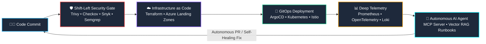

<!-- HERO BANNER -->

<!-- DYNAMIC TYPING SVG -->

  

<!-- STATUS & TELEMETRY PILLS -->

  
  
  

<!-- SOCIAL & QUICK ACTION BUTTONS -->

  
  
  
  

---

### 👨‍💻 Executive Overview

> *"The future of software delivery is neither manual nor purely automated—it is **autonomous, self-healing, and fortified by zero-trust security**."*

I am a **Lead DevSecOps Architect & AI Infrastructure Engineer** specialized in designing enterprise cloud platforms, impenetrable multi-layer security postures, and cutting-edge **Agentic AI workflows**. 

By bridging the gap between **Infrastructure as Code (IaC)**, **GitOps**, and **Model Context Protocol (MCP)**-driven autonomous agents, I transform static DevOps pipelines into intelligent, closed-loop ecosystems that detect vulnerabilities, optimize cloud expenditure, and heal production incidents in sub-seconds.

---

### ⚡ Measurable Enterprise Impact

| Metric | Enterprise Capability & Business Value |
| :--- | :--- |
| **99.999% Cloud Resilience** | Architected active-active multi-region cloud landing zones on Azure and AWS with automated failover and zero-data-loss topologies. |
| **70% Faster CI/CD Throughput** | Re-engineered monolithic pipelines into optimized GitOps workflows with parallelized testing, smart artifact caching, and ephemeral environments. |
| **100% Shift-Left Security** | Enforced automated Policy-as-Code (OPA/Kyverno) and container security gates blocking 100% of high/critical CVEs pre-deployment. |
| **75% MTTR Reduction with AI** | Deployed custom **MCP Servers & Autonomous AI Agents** that perform automated telemetry diagnostics, root-cause isolation, and self-healing PR submissions. |
| **40% FinOps Cost Savings** | Comprehensive cloud cost governance via rightsizing algorithms, spot orchestration, and automated idle resource decommissioning. |

---

### 🧠 The Autonomous AI-Powered DevSecOps Lifecycle

---

### 🛠️ Technical Arsenal & Core Competencies

  

 

<table>
  <tr>
    <td width="50%" valign="top">
      <h4>🛡️ 1. DevSecOps & Zero-Trust Cloud Security</h4>
      <ul>
        <li><b>Shift-Left Scanning:</b> SAST, DAST & SCA with <code>Trivy</code>, <code>Snyk</code>, <code>SonarQube</code>, <code>Checkov</code>, <code>Semgrep</code>, <code>tfsec</code></li>
        <li><b>Secrets & Identity:</b> <code>HashiCorp Vault</code> (PKI & Dynamic Secrets), <code>Azure Key Vault</code>, <code>AWS Secrets Manager</code></li>
        <li><b>Policy-as-Code:</b> <code>Open Policy Agent (OPA)</code>, <code>Kyverno</code> for CIS, SOC2, ISO27001 compliance</li>
        <li><b>Supply Chain Security:</b> <code>Cosign / Sigstore</code> image signing, SBOM generation (Syft/Grype), SLSA Level 3 compliance</li>
        <li><b>Runtime Defense:</b> <code>Falco</code> eBPF runtime threat detection and automated anomaly alerts</li>
      </ul>
    </td>
    <td width="50%" valign="top">
      <h4>☁️ 2. Cloud Platform, IaC & GitOps</h4>
      <ul>
        <li><b>Infrastructure as Code:</b> <code>Terraform (Enterprise Modules)</code>, <code>Terragrunt</code>, <code>OpenTofu</code>, <code>Ansible</code></li>
        <li><b>Container Orchestration:</b> <code>Kubernetes (AKS, EKS, Bare-Metal)</code>, <code>Helm</code>, <code>Kustomize</code>, <code>Docker</code></li>
        <li><b>Continuous Delivery:</b> <code>ArgoCD (GitOps)</code>, <code>GitHub Actions</code>, <code>GitLab CI/CD</code>, <code>Jenkins</code></li>
        <li><b>Cloud Architecture:</b> Azure Hub-Spoke, AWS Multi-Account Orgs, Transit Gateways, Zero Trust VPNs</li>
        <li><b>Service Mesh:</b> <code>Istio</code> (mTLS enforcement, canary rollouts, traffic splitting) & <code>Cilium (eBPF)</code></li>
      </ul>
    </td>
  </tr>
  <tr>
    <td width="50%" valign="top">
      <h4>🤖 3. AI Engineering, MCP, RAG & LLMOps</h4>
      <ul>
        <li><b>Model Context Protocol (MCP):</b> Custom <code>MCP Servers</code> bridging LLMs securely to K8s clusters, cloud APIs, and telemetry</li>
        <li><b>Autonomous Multi-Agent Systems:</b> <code>LangGraph</code>, <code>CrewAI</code>, and <code>AutoGen</code> deterministic workflow agents</li>
        <li><b>Enterprise Vector RAG:</b> Hybrid sparse-dense semantic search with <code>Qdrant</code>, <code>Pinecone</code>, <code>pgvector</code>, and cross-encoder re-ranking</li>
        <li><b>AI Guardrails & Telemetry:</b> <code>NeMo Guardrails</code>, prompt injection defense, <code>Langfuse</code> tracing, and token budgeting</li>
        <li><b>Local High-Throughput LLMs:</b> <code>vLLM</code>, <code>Ollama</code>, quantization (AWQ/GGUF), private self-hosted inference</li>
      </ul>
    </td>
    <td width="50%" valign="top">
      <h4>📊 4. Observability & Site Reliability Engineering</h4>
      <ul>
        <li><b>Metrics & Monitoring:</b> <code>Prometheus</code>, <code>Thanos</code>, <code>Grafana</code>, <code>Datadog</code>, <code>Azure Monitor</code></li>
        <li><b>Distributed Tracing & Logs:</b> <code>OpenTelemetry (OTel)</code>, <code>Jaeger</code>, <code>Loki</code>, <code>ELK / OpenSearch Stack</code></li>
        <li><b>Reliability Frameworks:</b> Automated SLI/SLO tracking, error budget burn alerting, automated runbook triggers</li>
        <li><b>Chaos Engineering:</b> Resilience testing using <code>Chaos Mesh</code> and <code>LitmusChaos</code> under high-concurrency loads</li>
        <li><b>Incident Management:</b> PagerDuty integrations, smart alert de-duplication, and blameless post-mortem automation</li>
      </ul>
    </td>
  </tr>
</table>

---

### 🚀 Featured Production Architectures & Flagship Repositories

<table>
  <tr>
    <td width="50%" valign="top">
      <h3>🤖 Autonomous SRE AI Agent (MCP Protocol)</h3>
      
An intelligent agentic incident-response engine built on the <b>Model Context Protocol (MCP)</b>. Directly connects LLMs to Kubernetes clusters, Prometheus metrics, and GitHub repos to diagnose crash loops, isolate root causes, and submit verified self-healing PRs.

      

        
        
        
        
      

      
🔗 <a href="https://github.com/Vijay141189/New-project-with-alerting"><b>Explore Repository: SRE Alerting & AI Agent</b></a>

    </td>
    <td width="50%" valign="top">
      <h3>🌐 Enterprise Multi-Region Cloud Landing Zone</h3>
      
Production-ready modular Terraform architecture implementing <b>Azure Hub-Spoke</b> network topology. Features centralized egress firewalls, automated IAM boundary controls, Key Vault secrets isolation, and FinOps budgeting policies.

      

        
        
        
      

      
🔗 <a href="https://github.com/Vijay141189/azure-landing-zone-terraform"><b>Explore Repository: Azure Landing Zone IaC</b></a>

    </td>
  </tr>
  <tr>
    <td width="50%" valign="top">
      <h3>🛡️ Zero-Trust Enterprise GitOps Platform</h3>
      
End-to-end multi-cloud Kubernetes deployment featuring <b>ArgoCD</b>, <b>HashiCorp Vault</b>, and <b>Kyverno</b> policy enforcement. Includes automated vulnerability scanning gates and zero-downtime canary rollouts via Istio Service Mesh.

      

        
        
        
      

      
🔗 <a href="https://github.com/Vijay141189/Azure-Monolithic-axion-"><b>Explore Repository: Monolithic to GitOps Migration</b></a>

    </td>
    <td width="50%" valign="top">
      <h3>📚 Enterprise Compliance & Operations RAG</h3>
      
Production-grade Retrieval-Augmented Generation pipeline enabling SRE and security engineers to query enterprise cloud runbooks, compliance benchmarks, and Terraform configs with sub-second semantic retrieval and hallucination guardrails.

      

        
        
        
      

      
🔗 <a href="https://github.com/Vijay141189/rgsg"><b>Explore Repository: Enterprise Ops RAG & IaC</b></a>

    </td>
  </tr>
  <tr>
    <td width="50%" valign="top">
      <h3>📊 Distributed Observability & Telemetry Framework</h3>
      
Comprehensive observability stack delivering sub-second anomaly detection across containerized microservices. Integrates Prometheus scraping, custom Grafana visualization suites, Loki distributed logging, and automated escalation.

      

        
        
        
      

      
🔗 <a href="https://github.com/Vijay141189/New-project-with-alerting"><b>Explore Repository: Advanced Alerting & Telemetry</b></a>

    </td>
    <td width="50%" valign="top">
      <h3>🏙️ Scalable Cloud-Native Real Estate Platform</h3>
      
High-concurrency microservices platform featuring PostgreSQL replication, high-throughput Redis caching, containerized CI/CD automated test suites, and dynamic multi-stage deployment workflows.

      

        
        
        
      

      
🔗 <a href="https://github.com/Vijay141189/project-Real-estate"><b>Explore Repository: Cloud Native Platform</b></a>

    </td>
  </tr>
</table>

---

### 📊 Real-Time GitHub Telemetry & Stats

  <table border="0">
    <tr>
      <td>
        
      </td>
      <td>
        
      </td>
    </tr>
  </table>

   

  

---

### 🏆 Professional Industry Credentials

  
  
  
  
  

---

### 🤝 Let's Architect the Future Together

Are you looking for an **Elite DevSecOps Architect**, a **Zero-Trust Cloud Platform Specialist**, or an **Autonomous AI Infrastructure Engineer** to build systems that scale securely to the highest enterprise standards?

   
  
  &nbsp;&nbsp;
  
  &nbsp;&nbsp;
  
  &nbsp;&nbsp;
  
    

  ⚡ Designed for extreme resilience, impenetrable zero-trust security, and the future of autonomous agentic cloud systems.

